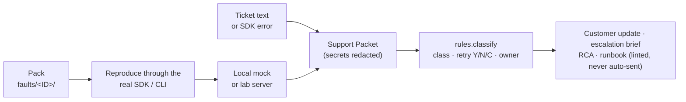

# support-casebook

[](https://github.com/su0xpj-bastion/support-casebook/actions/workflows/ci.yml)

**101 reproducible OpenAI and Anthropic support failures**, run against real SDKs, CLIs and protocol libraries. For each one the repo captures the evidence support needs, separates failures that look identical at the HTTP layer, and generates the customer update, escalation brief, RCA and runbook from that evidence.

| | |
|---|---|
| Packs | 101: API errors and HTTP-200 anomalies (OA/AN), agents/tools/MCP (AG), identity (ID/AN/OA), real CLIs (Claude Code 2.1.329, Codex 0.171.0), 3 incident sims |
| Runs against | openai 3.51.0, anthropic 2.9.0, Node openai 7.61.0 / @anthropic-ai/sdk 1.11.0, claude-agent-sdk, openai-agents, MCP Python 2.3.0 / TS 1.32.2, and a local mock; 3 packs captured live |
| Provenance | every expected error field is tagged `doc-verbatim`, `doc-partial`, `live-captured` or `synthesized` |
| Retry storm (SIM-2) | naive retries **~10×** the requests and never recover; SDK default ~1.75×; retry budget ~1.04× and recovers first |
| Silent degradation (SIM-3) | at 0.18% of traffic, hourly canaries catch it **0%** of the time; probing 10% of sessions catches it 90% |
| Triage eval | rules first, LLM fallback behind a guard: **0 false "retry" verdicts**, 0 secret leaks ([report](triage/eval/REPORT.md)) |
| SQL investigation | cases, triage answers, live captures and recorded request traces in SQLite; 7 saved queries answer support questions (which 429s need different fixes, wasted retries, every request id behind one call) and reproduce the published numbers ([`sql/`](sql/)) |
| Real findings | 4 EvalPlus issues, 2 Firefox bugs, Ollama silent truncation, 13 doc/SDK mismatches ([`real/`](real/)) |
| Suites | 6 more projects in [`suites/`](suites/), each with its own tests and CI: coding-agent grading, MCP server safety, agent API conformance, deep-research eval, streaming latency, support-ticket metrics |
| CI tooling | change-based test selection (12/12 injected faults caught, 0 misses), flake detection and quarantine, duration-based sharding (3 shards: 3 m 12 s vs 4 m 42 s), 10 failure signatures each reproduced, a local merge queue with bisection ([`docs/ci.md`](docs/ci.md)) |

```bash
uv venv -p python3.14 .venv && uv pip install -p .venv -r requirements.txt && (cd ts && npm ci)
.venv/bin/python -m casebook repro AN-01        # SDK default sends 3 requests, the evidence-aware policy sends 1
.venv/bin/python -m pytest -q                   # 660 tests, no network, ~4 min
```

## How it works



A customer's error, or a reproduction of it, becomes one evidence record. Deterministic rules decide what it is and whether retrying can help; an LLM is never trusted with that decision. Everything written for a customer is generated from that evidence and checked before a human sends it. Details: [architecture](docs/architecture.md), [workflows](docs/workflows.md).

## Same status code, different fix

| Pack | Status | The field that decides | Retry? | What to do |
|---|---|---|---|---|
| AN-01 | 429 | `error.details.error_code=enforced_spend_limit_reached`, **no `retry-after`** | **No** | Tier increase, or wait for 00:00 UTC on the 1st |
| AN-03 | 429 | `error.details.error_code=ramp_limit_exceeded`, `retry-after` present | Yes | Hold traffic steady; grow ≤1 step/min |
| AN-02 | **400** | message prefix `You have reached your specified … usage limits` (no code documented) | No | Raise the self-set spend limit |
| OA-04 | 429 | `error.code=credit_balance_exhausted` | **No** | Add prepaid credits |
| OA-05 | 429 | `error.code=project_spend_limit_exceeded` (other projects still work) | **No** | Raise the project limit |
| OA-10 | **503** | `error.code=server_is_overloaded` → Python `InternalServerError`, not `RateLimitError` | Yes | Backoff; check status page |

## API errors and HTTP-200 anomalies

```text
$ python -m casebook repro all --fast
pack   status code                                 verdict                      retry sdk-default policy  exception
AN-01  429    enforced_spend_limit_reached         billing.tier_spend_cap       N               3      1  anthropic.EnforcedSpendLimitReachedError
AN-02  400    invalid_request_error                billing.self_set_spend_limit N               1      1  anthropic.BadRequestError
AN-03  429    ramp_limit_exceeded                  limits.ramp                  Y               3      3  anthropic.RampLimitExceededError
AN-04  429    rate_limit_error                     limits.rate                  Y               3      3  anthropic.RateLimitError
AN-05  429    rate_limit_error                     limits.workspace             Y               3      3  anthropic.RateLimitError
AN-08  529    overloaded_error                     provider.capacity            Y               3      3  anthropic.OverloadedError
AN-09  200    overloaded_error                     provider.capacity            Y               1    n/a  anthropic.APIStatusError
AN-11  504    timeout_error                        provider.timeout             C               3      1  anthropic.GatewayTimeoutError
AN-12  401    authentication_error                 auth.cors_blocked            N               1      1  anthropic.AuthenticationError
AN-13  401    authentication_error                 auth.invalid                 N               1      1  anthropic.AuthenticationError
AN-14  401    authentication_error                 auth.invalid                 N               1      1  anthropic.AuthenticationError
AN-15  402    billing_error                        billing.payment              N               1      1  anthropic.APIStatusError
AN-16  413    -                                    request.too_large            N               1      1  anthropic.ContentTooLargeError
OA-01  429    rate_limit_exceeded                  limits.rate                  Y               3      3  openai.RateLimitError
OA-02  429    slow_down                            limits.ramp                  Y               3      3  openai.RateLimitError
OA-04  429    credit_balance_exhausted             billing.credits_exhausted    N               3      1  openai.RateLimitError
OA-05  429    project_spend_limit_exceeded         billing.spend_limit          N               3      1  openai.RateLimitError
OA-06  429    organization_usage_limit_exceeded    billing.usage_limit          N               3      1  openai.RateLimitError
OA-07  401    invalid_api_key                      auth.invalid                 N               1      1  openai.AuthenticationError
OA-08  403    unsupported_country_region_territory auth.region                  N               1      1  openai.PermissionDeniedError
OA-10  503    server_is_overloaded                 provider.capacity            Y               3      3  openai.InternalServerError
OA-11  400    invalid_request_error                config.service_tier          N               1      1  openai.BadRequestError
OA-12  429    rate_limit_error                     capacity.flex                Y               3      3  openai.RateLimitError
OA-14  -      client_timeout                       client.timeout               C               3      1  openai.APITimeoutError

pack   requests  finding
AN-06         2  cache.below_minimum: cache_control sent but both cache fields are 0: prefix is under the model's minimum, so nothing is cached and no error is returned
AN-07         3  cache.prefix_drift: repeat request wrote the cache again instead of reading it: the prefix changed
AN-10         0  ValueError before send: Streaming is required for operations that may take longer than 10 minu
OA-13         1  billing.tier_downgraded: requested service_tier=priority but served default; billed at the served tier
OA-15         1  billing.wrong_org: billed to org-personal-sandbox, expected org-casebook0001; set OpenAI-Organization / OpenAI-Project
```

`sdk-default` and `policy` count requests sent for one user action. The Node SDKs send the same counts on every error pack (`tests/test_ts_sdks.py`).

Findings (mock):
1. **Default SDK retries resend non-retryable errors.** All four SDKs send 3 requests for every 429, including billing codes. Both Anthropic SDKs raise `EnforcedSpendLimitReachedError` and still retry it twice. The evidence-aware policy sends 1.
2. **An SDK-retried timeout is three copies of the work.** OA-14 and AN-11 both produce 3 server-side requests; AN-11 creates three request-ids for one logical call.
3. **A mid-stream overload is not an `OverloadedError`.** AN-09 arrives after HTTP 200 as `anthropic.APIStatusError` with status 200, so 5xx retry logic never sees it.
4. **Some failures can't be identified from the response.** AN-13 (rotated key) and AN-14 (archived workspace) return the same 401 body.
5. **Some failures leave no request-id.** AN-16, OA-14 and AN-10. The packet lists what to collect instead: `X-Client-Request-Id`, UTC timestamp, org/project, payload size.
6. **Some failures are HTTP 200:** tier downgrade (OA-13), wrong-org billing (OA-15), cache below minimum (AN-06), prefix drift (AN-07).

Whether the real APIs send `x-should-retry` on these errors is unverified except where a live capture exists.

## Streams, long-running calls, structured output, batches

```text
OA-16  client.timeout_default: SDK default read timeout: openai 600s, anthropic 600s
OA-17  stream.usage_lost: include_usage was set but the stream ended before the usage chunk
OA-18  stream.failed_event: HTTP 200 stream ended with response.failed; handle the event, not the status
OA-19  stream.resumed: stream dropped after seq 3; resumed with starting_after=3; no gaps or duplicates
OA-21  output.refusal_or_length: refusal -> parsed=None (message.refusal set); length -> LengthFinishReasonError
OA-22  schema.not_strict: $: additionalProperties must be false; $: not in required: ['note']
AN-17  context.400_vs_200: input over window -> 400 'prompt is too long…'; input fits -> 200 model_context_window_exceeded
AN-22  tools.text_after_result: text appended after tool_result blocks: send tool_result blocks alone
AN-23  model.refusal: stop_reason=refusal is a normal 200: the model declined; not an outage
AN-24  batch.reconcile: 10/10 results out of request order; resubmit 4 (errored/expired are not billed)
```

OA-17 also shows the common bug: `chunk.choices[0]` raises `IndexError` on the usage chunk.

## Migrations and proactive exposure

The mock enforces the lifecycle and capability facts in `casebook/models.py` with a mock clock (`X-Casebook-Date`), so the same request passes before a change and fails after it:

```text
AN-18  migration.400s: prefill 400→200; thinking_enabled 400→200; sampling_params 400→200; computer_tool_version 400→200
AN-19  same request: Sonnet 4.5 200, Sonnet 5.5 400; fix auto+strict -> 200
AN-20  verbatim history 200; first message edited 400 (thinking signature bound to the conversation)
AN-21  SDK 2.9.0: temperature= raises TypeError before sending; forced via extra_body under 2026-10-21 -> 400; pinned 2023-06-01 -> 200
AN-26  claude-sonnet-4-5-20250929: 2026-11-29 200, 2026-11-30 404 (status synthesized)
OA-24  gpt-4o: 2027-01-13 200, 2027-01-14 404 (status synthesized)
```

- **anthropic 2.9.0 removed `temperature` from `messages.create()`.** Old code fails with a `TypeError` before sending, with no request-id; raw-HTTP callers get a 400.
- **anthropic 2.9.0's retirement `DeprecationWarning`** is hidden by Python's default filters outside `__main__`, so most services never print it.

**Exposure scanner** (`python -m casebook exposure cases/dossiers/*.yaml --draft`) reads an account dossier and its code, returns dated, located findings, and drafts a note for the account team. Drafts only. Accounts are fictional; `clean-co` is the false-positive control and must produce zero findings. Examples: [`cases/examples/`](cases/examples/).

```text
Acme Mutual Insurance (fictional)  (as of 2026-11-19, 3 files)
  P1 2026-11-30 AN-26  .../agents/subagents.yaml:3          claude-sonnet-4-5: retires in 11 days (2026-11-30)
  P1 2026-11-30 AN-26  .../claims_service/triage.py:4       claude-sonnet-4-5-20250929: retires in 11 days (2026-11-30)
  P2 2026-12-08 AN-21  dossier: dependencies                anthropic 1.4.2 -> 2.x planned 2026-12-08: API version becomes 2026-10-21
  P2 -          AN-19  .../agents/adjuster_copilot.py:13    forced tool_choice with claude-opus-5-5 -> 400 on this model
  P2 -          AN-18  .../agents/adjuster_copilot.py:14    thinking.type enabled on a 4.7+/5.x model -> 400
  P2 -          AN-21  .../claims_service/triage.py:11      sampling parameter in a Claude call: TypeError on anthropic>=2 SDK, 400 under 2026-10-21
  ...
```

## Agents, tool use, MCP

AG-22..24 run the real Claude Agent SDK (0.2.186, bundled Claude Code 2.1.329) and AG-26/27 the real OpenAI Agents SDK (0.25.0), against the mock with isolated config.

```text
AG-01  missing tool_result 400 (doc-verbatim text), text before result 400, results first 200
AG-02  mixed server/client turn: text added 400, web_fetch dropped from tools 400, only tool_result + same tools 200
AG-03  pause_turn continued without the container id: 'FileNotFoundError: report.csv' (no error); with it: found
AG-04  ZDR org + web_search_20260209 without allowed_callers 400; ["direct"] 200; allowed+blocked domains 400
AG-05  failing tool + no retry cap: still looping after 20 model calls; capped at 3, then escalate
AG-06  strict=true sent, loose schema: echoed strict=False, no error; fixed schema: True
AG-07  gpt-4.1-nano: 2 identical parallel calls; parallel_tool_calls=false -> 1
AG-08  stateless replay dropped 1 reasoning item (lint)
AG-09  previous_response_id chain: input tokens per turn [16, 37, 58, 79, 100] — each turn re-bills the chain
AG-10  remote MCP: turn 1 ok; turn 2 without authorization -> 401 at tool listing; resent -> ok; never echoed
AG-11  default require_approval: turn 1 stops at mcp_approval_request ("stuck"); approval -> mcp_call
AG-12  connector_id on a post-2026-09-01 model 400; server_url 200
AG-13  MCP connector: undefined server 400; typo in configs -> 200, no tool call (silent no-op)
AG-14  local/stdio-style MCP URL -> 400: needs a public https URL
AG-15  claude.ai connector config lint: https, port 443, public host, OAuth callback
AG-22  headless Claude Agent SDK run: Bash denied ('… needs approval'), yet ResultMessage subtype=success, is_error=False
AG-23  allowed_tools=['Bash'] + can_use_tool: callback never called; SDK warns; callback alone: called
AG-24  allowed_tools=['Read'] + bypassPermissions: Bash still runs; disallowed_tools=['Bash']: blocked
AG-26  OpenAI Agents SDK: MaxTurnsExceeded after 3 model calls; input guardrail tripwire before any model call
AG-27  session + previous_response_id -> UserError: "Session persistence cannot be combined with ... previous_response_id"
AG-28  refund executed, follow-up timed out, turn replayed: 2 refunds with different call_ids; business-key dedupe: 1
```

- **AG-22:** a headless agent whose tool was denied still reports success. Monitor denied tool results, not the result subtype.
- **AG-28:** `call_id` dedupe doesn't stop a replayed side effect; the model issues a new `call_id`. Guard on a business key.

### MCP interop between two real SDKs

`casebook/mcp_lab/` runs real servers and clients from Python `mcp` 2.3.0 (2026-07-28 revision, also serves the older handshake) and TypeScript `@modelcontextprotocol/sdk` 1.32.2 (2025-11-25 only), with a proxy that strips, rewrites or buffers like a gateway.

```text
AG-16  old TS client -> new Python server: works. New client 'auto' -> old server: works after one rejected probe.
       New client pinned 2026-07-28 -> old server: fails ("Bad Request: No valid session ID provided")
AG-17  gateway drops Mcp-Method/Mcp-Name: pinned client -> "mcp-method header does not match the request body's method";
       'auto' client silently downgrades to 2025-11-25. Rewritten MCP-Protocol-Version -> "Bad Request: Missing session ID"
AG-18  first progress event: direct 0.0 s; buffering proxy honouring X-Accel-Buffering 0.0 s; header dropped upstream 1.61 s
AG-19  missing scope -> 403 insufficient_scope; wrong audience -> 401, byte-identical to no token; good token -> 200
AG-20  DCR-only client vs CIMD-only AS -> "OAuthRegistrationError: Registration failed: 404 Not Found"; metadata URL -> works
AG-21  one malformed tool: Python reference server fails tools/list for everyone (-32603); third-party server sending it ->
       Python ValidationError, TS ZodError. Neither drops just the bad tool
```

## Real Claude Code and Codex CLIs

`casebook/client_lab/` runs Claude Code 2.1.329 and Codex 0.171.0 against the mock with throwaway config homes; nothing reaches Anthropic or OpenAI. TLS packs use a generated "corporate inspection" CA; the OTel pack runs a local OTLP collector.

```text
AN-44  ANTHROPIC_API_KEY + ANTHROPIC_AUTH_TOKEN both set: x-api-key AND Authorization: Bearer are both sent
AN-45  forceLoginOrgUUID + env API key: exit 1 before any request; forceLoginMethod=claudeai alone: not blocked
AN-50  untrusted chain: SELF_SIGNED_CERT_IN_CHAIN; NODE_EXTRA_CA_CERTS -> ok; wrong CA path -> stderr warning, same TLS error
AN-51  HTTPS_PROXY=socks5://…: no error, no request — the CLI hangs
AN-55  apiKeyHelper exits 1: "apiKeyHelper failed: exited 1: …" and the request is still sent with an empty Bearer
AN-56  OTLP exports from process env and user settings; none from project settings
OA-43  API key stored + forced_login_method=chatgpt: `codex exec` logs out and deletes auth.json; `login status` says only "Not logged in"
OA-48  untrusted chain: "Reconnecting... waiting for network" until killed; CODEX_CA_CERTIFICATE -> ok; SSL_CERT_FILE -> ok
```

AN-51 and OA-48 show misconfigured networks as hangs, not errors: collect proxy and CA settings before reading error text. AN-45 delivers policy via the CLI's `--managed-settings` flag (the system path needs sudo), so a real managed file may behave differently.

## Identity lab (stand-in IdP)

`casebook/identity/`: a stand-in IdP issuing signed SAML 2.0, a service provider modelled on Claude's documented SSO/provisioning rules, a SCIM 2.0 directory, an OAuth/OIDC AS and RP, and a WIF exchange modelled on OpenAI Workload Identity Federation. Signatures, JWT/JWKS and X.509 are real (signxml 5.3.0, PyJWT 2.15.1); policy decisions are modelled from vendor docs and are not Anthropic's or OpenAI's systems.

```text
scope: protocol (SAML / OAuth / OIDC behaviour)
ID-01  NameID 'dito' -> saml.nameid_not_email; unverified alias -> sso.domain_not_verified; primary email -> ok
ID-02  IdP clock +180 s -> saml.not_yet_valid; used 10 min later -> saml.expired; +45 s within 60 s skew -> ok
ID-03  IdP app copied from an old org: Audience -> saml.audience_mismatch; ACS -> saml.destination_mismatch
ID-04  IdP rotated its cert, SP not updated -> saml.signature_invalid; SP metadata updated -> ok
ID-05  redirect_uri trailing slash / http -> invalid_request shown by the AS; never redirected back
ID-06  revoked refresh token, reused code -> invalid_grant (retries never help)
ID-07  key rotated + old key pulled: refetch-on-unknown-kid RP ok; 600 s cache RP fails; trailing-slash iss rejected
AN-33  IdP cert expired + Require SSO: nobody can sign in to fix it; recovery via Support from an Owner email

scope: vendor-policy (modelled from vendor docs)
AN-32  TXT on www / wrong case / domain re-added -> pending; new value at root -> verified
AN-35  Require SSO: personal-account owner not in the IdP app can't sign in
AN-36  SCIM saved with 10 of 40 users assigned: guard previews 30 removals; saved anyway -> 30 deprovisioned, Primary Owner exempt
AN-37  group mappings enabled by an admin in no Admin-mapped group: that admin -> user
AN-38  JIT: removed only in Claude -> back at next login; unassigned only in IdP -> keeps a premium seat
OA-30  ChatGPT SCIM: removed in workspace only -> re-created by next sync; IdP unassign -> gone
OA-38  WIF: a second, broader mapping also matches -> invalid_grant ("exactly one required")
OA-39  WIF: JWKS not updated before new kid -> invalid_grant; discovery refresh -> ok; tokens from removed key -> invalid_grant
OA-40  WIF wildcards: '*', 'repo:*/main', 'repo:org/*:main' rejected; 'repo:org/app:*' accepted
OA-41  WIF: 6 h subject token -> 3600 s access token; 20 min subject -> 1200 s; no refresh token
```

signxml raises `InvalidSignature` for an expired IdP certificate, so cert expiry can look like a signature problem in logs. The SP classifies it correctly and a test pins the library behaviour.

## Incident sims

Each sim injects a fault, drives real SDK clients, measures the result, and generates the customer update, escalation brief and RCA. Every update passes the linter: six sections, no secrets, no retry advice on non-retryable failures, no unevidenced root cause, a next-update time on P1. Outputs: [`cases/sims/`](cases/sims/).

| Sim | Template | What runs | Measured |
|---|---|---|---|
| SIM-1 provider outage | OpenAI 2024-12-11 | Mock drops connections and 503s model listing; 10 SDK clients, one with a revoked key as control | Classified provider-side **5 min** after impact from client signals alone; control always reads customer-side; 3 P1 updates, 0 lint problems |
| SIM-2 retry storm | OpenAI 2026-04-20 | Capacity 10 rps for 3 s then 60 rps; 20 SDK clients × 3 strategies | Amplification **naive ~9.95×** (never recovers), **SDK default ~1.75×** (2–5 s), **retry budget ~1.04×** (1 s) |
| SIM-3 silent degradation | Anthropic 2025-09-17 | Sticky slice of sessions gets corrupted answers; hourly canaries vs 10% session probes | 16% slice: both catch it in hour one. **0.18%: canaries 0%, probes 90%**. Every degraded answer is HTTP 200 |

- **Generators** (`casebook/gen/`): customer updates, escalation briefs, five-part RCAs, update linter.
- **Runbooks** (`python -m casebook runbooks`): one per pack in [`runbooks/`](runbooks/): confirm, fix, customer guidance, when to escalate, provenance.
- **Doc drift** (`tools/doc_links.py --check`): checks every cited URL weekly in CI.

## Triage eval

`casebook/triage/` works in three layers; retryability always comes from a class table, never from model text:
- **Rules:** redact, build a packet, apply documented codes and message phrases. A bare "429" is not enough.
- **LLM:** one Chat Completions call returning a class plus quotes that must appear verbatim in the ticket.
- **Combined:** rules first; the LLM only gets undecided tickets, behind a guard that turns a code-less "retryable" class or an invented quote into "needs more info".

260 tickets (240 synthetic with full / partial / vague evidence, misleading framing and 55 planted keys; 20 adversarial), split by error family, on two free local models via Ollama. [Full report](triage/eval/REPORT.md).

| Mode | Strict | Safe (errors = failures) | False "retry" | Wrong | LLM errors | Key leaks |
|---|---|---|---|---|---|---|
| rules | 0.564 | 1.000 | **0** | 0 | 0 | 0 |
| LLM alone · qwen2.5:1.5b | 0.506 | 0.572 | **25** | 66 | 37 | 0 |
| LLM alone · gemma3:1b | 0.362 | 0.393 | **49** | 135 | 14 | 0 |
| combined · qwen2.5:1.5b | 0.661 | 0.903 | **0** | 16 | 9 | 0 |
| combined · gemma3:1b | 0.626 | 0.953 | **0** | 5 | 7 | 0 |

An LLM alone is unsafe at this size; the guard holds false "retry" at 0 for both. Combined output goes to a human as a draft; only rules-only answers go to customers automatically.

## Investigating with SQL

`python -m casebook sql load --repro` loads the cases, the 260 triage tickets and every model's answers, the live captures, and a fresh repro of every error case against the mock (each HTTP request with its request id and the SDK's retry count) into SQLite. Saved queries in [`sql/queries/`](sql/queries/) answer the questions support asks first:

```text
$ python -m casebook sql query wasted_retries
pack   status  error_code                         sdk_default_requests  policy_requests  wasted
AN-01  429     enforced_spend_limit_reached       3                     1                2
OA-04  429     credit_balance_exhausted           3                     1                2
OA-05  429     project_spend_limit_exceeded       3                     1                2
OA-06  429     organization_usage_limit_exceeded  3                     1                2

$ python -m casebook sql query request_trace --param pack=AN-11
mode         seq  path          request_id                    retry_count
sdk-default  1    /v1/messages  req_011fEGmKKrf97m3yJYKQeXVU  0
sdk-default  2    /v1/messages  req_011e9ZL2EKy6JnhoIA57sdPO  1
sdk-default  3    /v1/messages  req_011ZrVRceKZzLENHslnLvSpP  2
```

| Query | Question it answers |
|---|---|
| `same_status_different_fix` | Which HTTP statuses hide cases that need different fixes (the ten 429s split into 8 different verdicts) |
| `wasted_retries` | Requests SDK default retries send for failures retrying can't fix |
| `request_trace` | Every request behind one user action, with the request id each attempt got |
| `missing_request_id` | Failures that leave the customer no request id to quote |
| `triage_false_retry` | Per model and mode: wrong "retry" advice, wrong answers, model errors, leaks |
| `triage_wrong_by_family` | Where an LLM-alone triage goes wrong, by error family and evidence level |
| `live_vs_expected` | Real-API captures: fields matched and whether the server said to retry |

`tests/test_sql.py` checks that the queries reproduce the published triage numbers and the repro results.

## Live captures

`python -m casebook live <packs> --yes` sends the real request and writes `faults/.../live/<date>-python.json`: status, redacted headers, body, SDK versions, and a diff against `expected.json`.

| Pack | Live result (2026-11-19, fake key, no cost) |
|---|---|
| OA-07 | 401 `invalid_api_key`, **no `x-should-retry`**; extra `status` field; `x-error-json` header is a base64 copy of the body, so redaction now decodes it |
| AN-13 | 401 `authentication_error`, **`x-should-retry: false`**, every field matched |
| AN-16 | 33 MiB body with an invalid key returned **401 JSON, not 413**: auth runs first or the edge limit is higher |

Pending (need a keyed account): AN-02, OA-05, OA-11 (`live_setup` in each `pack.yaml`, run with `--keyed --yes`); AN-26 after 2026-11-30.

## CI tooling

`casebook/ci/` runs this repo's own suite: selection, history, reruns, sharding, failure signatures, and a merge queue. Every number below comes from running the suite or real git on this machine; raw results are in [`ci/reports/`](ci/reports/).

```text
CI-01  infra        Y  port already in use (fixed port collided)            reproduced: bind a listening port twice
CI-02  flake        Y  temp-dir cleanup raced a child process              reproduced: rmdir after a late write
CI-03  infra        Y  subprocess exceeded its timeout                      reproduced: child sleeps past timeout
CI-04  environment  Y  DNS lookup failed (test reached an external host)    reproduced: resolve a .invalid host
CI-05  dependency   N  Node package missing                                 reproduced: require() an uninstalled package
CI-06  dependency   N  Python module missing                                reproduced: import an uninstalled module
CI-07  regression   N  test file doesn't import (syntax error)              reproduced: broken test file
CI-08  regression   N  generated docs/test-matrix.md is stale               reproduced: git diff --exit-code on the file
CI-09  regression   N  broken doc link or moved line link                   reproduced: tools/check_docs.py on a bad link
CI-10  regression   N  assertion fails on every attempt                     reproduced: wrong expectation on rules.classify
CI-00  unknown      C  no signature: rerun once, then add one
```

| Feature | Measured |
|---|---|
| Test selection (`ci select`) | A one-module change runs a median 14% of suite time; 13 core modules still need over 75%. Fault injection into 12 modules: **12/12 caught by the selected tests, 0 caught only by unselected tests**. The first run found a test gap (policy retry trace untested) and two hidden test dependencies; both fixed |
| Flakes and quarantine (`ci test`, `ci quarantine`) | 5 full runs on one commit, 3,130 test executions: no failures, no flips. A test built to flake is caught: fails, passes on rerun, reported as flaky, build stays green |
| Sharding (`ci shard`, `ci-shards.yml`) | 3 shards on GitHub Actions finished within 6 s of each other; workflow 3 m 12 s vs 4 m 42 s single job, for about 1.7× the runner time |
| Merge queue (`casebook/ci/mergequeue.py`) | 16 branches on real git: batch 4 needs 4 test runs instead of 13 when nothing fails; with 2 breaking branches and 1 conflict, batch 8 needs 14 vs 15 serial. Base passes its tests after every run |

Not here: Kubernetes or multi-cloud runners, cluster load shedding, GitHub's merge queue (needs an organisation-owned repo).

## Suites

Six more projects live in [`suites/`](suites/). Each keeps its own README, dependencies and tests, and has its own GitHub Actions workflow that runs only when its folder changes.

| Suite | What it is, in plain terms | Tests |
|---|---|---|
| [coding-agent-qa](suites/coding-agent-qa/) | Gives an AI coding agent small bugs to fix, grades the fix with tests it never saw, fails it for editing the tests, and decides go / no-go across repeated runs | 39 |
| [mcp-server-qa](suites/mcp-server-qa/) | A tool server that AI assistants use to read and update incident tickets, plus safety tests: logins, file access, planted instructions; 12 planted bugs, each caught (TypeScript) | 51 |
| [agent-api-conformance](suites/agent-api-conformance/) | The same 12 agent scenarios (streaming, tools, structured output, caching, prompt injection) run through OpenAI Responses, Anthropic Messages and Chat Completions | 25 |
| [deep-research-eval](suites/deep-research-eval/) | A release gate for research agents on 60 fixed questions: right, incomplete, padded or wrong, decided with a statistical test | 25 |
| [token-stream-meter](suites/token-stream-meter/) | Measures how fast a streamed answer arrives: time to first token, gap between tokens, total time | 18 |
| [api-metrics-analyzer](suites/api-metrics-analyzer/) | Reads API usage metrics from a support ticket and returns a diagnosis with severity, root causes and fixes (Python 3.12, mocked OpenAI client) | 86 |

## Documentation

| Doc | For |
|---|---|
| [Architecture](docs/architecture.md) | Components, data model, CI, design decisions |
| [Workflows](docs/workflows.md) | Traced call sequences for the seven workflows |
| [Code reference](docs/code-reference.md) | Public functions with callers and tests |
| [Testing](docs/testing.md) · [Test matrix](docs/test-matrix.md) | Test layers, what isn't tested, per-pack coverage (generated) |
| [Business value](docs/business-value.md) | What was measured, an ROI model with stated assumptions, use cases |
| [Security and reliability](docs/security-reliability.md) | Secrets, retries, timeouts, gaps, limitations |
| [CI tooling](docs/ci.md) | Test selection, flakes and quarantine, sharding, failure signatures, merge queue, with measured results |
| [Glossary](docs/glossary.md) | Terms used across the repo |

## Run

```bash
uv venv -p python3.14 .venv && uv pip install -p .venv -r requirements.txt
(cd ts && npm ci)                                   # Node SDKs for tests/test_ts_sdks.py (skipped if absent)
.venv/bin/python -m pytest -q                       # never touches the real APIs
.venv/bin/python -m casebook packs                  # tier, retry verdict, provenance
.venv/bin/python -m casebook repro all --fast
.venv/bin/python -m casebook redact ticket.txt --provider anthropic   # redact + packet + verdict
.venv/bin/python -m casebook.mockserver --port 8787 # header X-Casebook-Pack selects a fault
.venv/bin/python -m casebook ci select --base origin/main --explain   # tests the change can affect, and why
.venv/bin/python -m casebook sql load --repro && .venv/bin/python -m casebook sql query wasted_retries
.venv/bin/python -m casebook ci test --base origin/main               # run them, rerun failures, classify the rest
```

## Layout

```
casebook/
  redact.py      key/JWT/Bearer redaction (documented prefixes; wrapped and JSON-escaped keys)
  packet.py      Support Packet builder: from HTTP, SDK exceptions, ticket text
  rules.py       deterministic triage: packet -> class, retryable Y/N/C, owner, basis, confidence
  checks.py      HTTP-200 anomalies
  policy.py      SDK retries off; retry decided per attempt from the packet
  mockserver.py  OpenAI + Anthropic wire format, fault modes, prompt-cache accounting
  repro.py, scenarios.py, ts_repro.py           packs through the Python and Node SDKs
  models.py      model lifecycle + capability facts
  exposure.py    account exposure scan + draft note
  mock_agents.py, agent_scenarios.py, agent_sdk_scenarios.py   AG packs
  triage/        rules + LLM triage, dataset, eval
  sims/          SIM-1/2/3
  gen/           updates, escalations, RCAs, linter, runbooks
  identity/      stand-in IdP, SP, SCIM, OAuth/OIDC, WIF
  client_lab/    Claude Code + Codex CLIs, TLS CA, OTLP collector
  mcp_lab/       MCP servers/clients (Python + TS), proxy, OAuth stand-in
  live.py        real-API captures + diff vs expected.json
  logdb.py       loads cases, triage answers, captures and request traces into SQLite for sql/queries/
  ci/            test selection, flake history + quarantine, sharding, failure signatures, merge queue
suites/          six self-contained projects, each with its own tests and workflow
ci/              quarantine list, recorded durations, experiment reports
sql/             schema and saved support queries
faults/<provider>/<ID>-<slug>/  pack.yaml  expected.json  fix.md
tests/           incl. tests/ci_cases/: small failures the signature tests reproduce
```

## Provenance rules

- Each field in `expected.json` is tagged `doc-verbatim`, `doc-partial`, `synthesized` or `live-captured`; a pack's provenance is its weakest field.
- Status and error codes are doc-verbatim. Most message text is not; neither provider publishes full messages.
- Rules matching message text (AN-02, AN-12, OA-08, OA-11) report `confidence: message-prefix`. AN-05 is a header heuristic.
- Packs run against the mock unless a `live/` capture exists.
- Not covered: packs needing a real enterprise tenant, sudo/MDM, Windows, or paid keys.
- Corrections: AG-16 (no loop against a dual-era server), AG-18 (the SDK does send `X-Accel-Buffering`), AN-14 (owner is the customer), 2 hand-written doc URLs that returned 404, LLM errors once scored as safe abstains, and two test dependencies the import graph missed (found by fault injection).

## Sources

- https://developers.openai.com/api/docs/guides/error-codes
- https://developers.openai.com/api/docs/guides/rate-limits
- https://platform.claude.com/docs/en/api/errors
- https://platform.claude.com/docs/en/api/rate-limits
- https://platform.claude.com/docs/en/build-with-claude/streaming
- https://platform.claude.com/docs/en/build-with-claude/prompt-caching
- https://developers.openai.com/api/docs/guides/flex-processing
