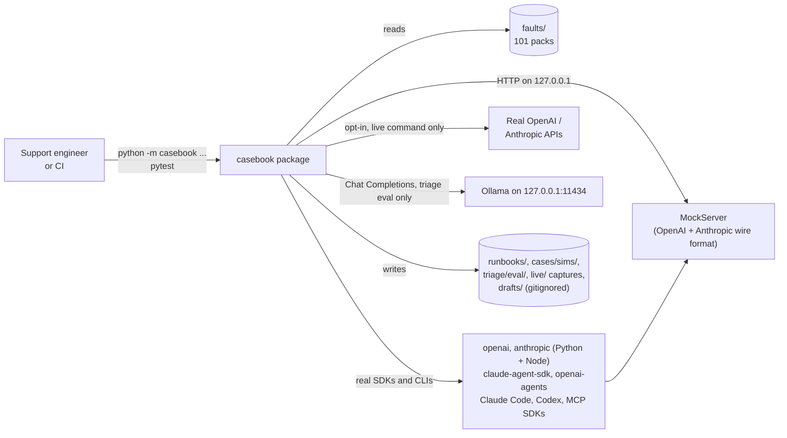
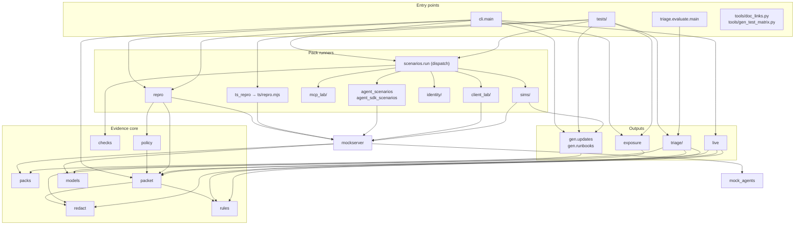
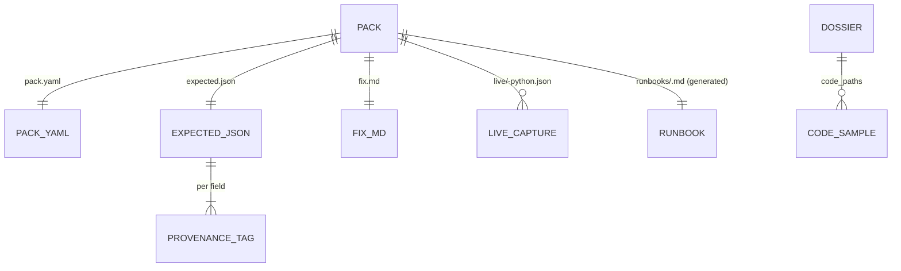

# Architecture

## In one paragraph

support-casebook is a Python package with a command-line interface and a test suite. It runs nowhere as a service. Each support failure is described as a **pack** (files under `faults/`). Code in `casebook/` reproduces the pack against a local mock of the OpenAI and Anthropic APIs, or against a local lab (MCP, identity, CLIs). It records what happened as a **Support Packet**, classifies it with deterministic **rules**, and writes customer-facing and internal text from that evidence. Tests assert each pack's expected outcome.

What this system is **not**: there is no database, web frontend, queue, deployed service, or user login. Persistent state is the files in the repo. The only scheduled job is a weekly link check in GitHub Actions.

## System context

Network access to real providers happens only in two places, both run by hand: `python -m casebook live` ([`live.capture`](../casebook/live.py#L54)) and `tools/doc_links.py --check`. The test suite never calls a real API.

## Components

### Evidence core

| Component | Responsibility | Called by | Calls | If it fails |
|---|---|---|---|---|
| [`packs`](../casebook/packs.py) | Load every `faults/*/*/pack.yaml` + `expected.json` into `Pack` objects; compute a pack's weakest provenance | almost everything | `yaml`, `json` | A malformed pack raises at load; `test_pack_metadata_complete` names it |
| [`redact`](../casebook/redact.py) | Replace documented key prefixes, Bearer tokens and JWTs with `[REDACTED:kind]`; drop secret headers; decode and scan base64 `x-error-json` | `packet`, `live`, `triage`, `gen.updates.lint_update` | `re`, `base64` | Unknown key formats pass through. `test_red_03_lookalikes_are_not_redacted` pins what is deliberately not redacted |
| [`packet`](../casebook/packet.py) | Build the Support Packet (one dict schema, `schema/packet.schema.json`) from an HTTP response, an SDK exception, a client error, or ticket text | `repro`, `policy`, `live`, `scenarios`, `sims`, `triage` | `redact` | Missing fields become `None` with a warning telling support what to ask for |
| [`rules`](../casebook/rules.py) | Packet → `Verdict` (class, retryable Y/N/C, owner, basis, confidence, doc URL) | `policy._decide`, `repro`, `live`, `triage`, `cli` | nothing | Unknown input → `unknown`, retry `C`, owner `support` |
| [`policy`](../casebook/policy.py) | Retry wrapper with SDK retries off; retries only when `rules` says `Y` | `repro.run` (policy mode) | SDK, `packet`, `rules` | Re-raises the last SDK exception unchanged (bare `raise`) |
| [`checks`](../casebook/checks.py) | Detect failures that return HTTP 200 (tier downgrade, wrong org, cache miss, stream usage lost, schema not strict, batch reconciliation…) | `scenarios`, `agent_scenarios`, tests | nothing | Returns `None` when nothing is wrong |
| [`models`](../casebook/models.py) | Model retirement dates and capability restrictions, as data | `mockserver`, `exposure` | nothing | Dates are a snapshot; `doc-drift` CI checks the source URLs, not the dates |

### Mock and labs

| Component | Responsibility | Notes |
|---|---|---|
| [`mockserver`](../casebook/mockserver.py) | `MockServer` runs a threaded HTTP(S) server on a free port. `Handler.do_POST` routes `/chat/completions`, `/messages`, `/responses`, batches and `count_tokens`; the `X-Casebook-Pack` header selects a fault, and the pack's `expected.json` `mode` decides behaviour (`replay`, `raw`, `delay`, `success`, `sse_error`, `outage`, `capacity`, `degraded_slice`, agent modes) | `State` counts requests per pack, which is how every "requests sent" number is measured |
| [`mock_agents`](../casebook/mock_agents.py) | Tool-use, server-tool and MCP-connector behaviour for the mock | Used by `Handler` for AG packs |
| [`ts_repro`](../casebook/ts_repro.py) | Runs `ts/repro.mjs` with the official Node SDKs against the mock | Skipped if Node or `ts/node_modules` is missing |
| [`mcp_lab/`](../casebook/mcp_lab/) | Real MCP servers and clients (Python `mcp` 2.3.0, TS SDK 1.32.2), a header-mangling proxy, an OAuth stand-in | AG-16..21 |
| [`client_lab/`](../casebook/client_lab/) | Runs the real Claude Code and Codex CLIs with throwaway config homes, a generated TLS-inspection CA, an OTLP collector | AN-44..56, OA-43, OA-48 |
| [`identity/`](../casebook/identity/) | Stand-in SAML IdP, a service provider modelled on Claude's documented rules, SCIM store, OAuth/OIDC AS + RP, WIF exchange | Signatures and JWTs are real; policy is modelled |
| [`sims/`](../casebook/sims/) | Three incident simulations that drive many SDK clients concurrently against the mock | SIM-1/2/3; `artifacts.py` writes `cases/sims/` |

### Outputs

| Component | Responsibility |
|---|---|
| [`gen/updates.py`](../casebook/gen/updates.py) | Customer update (6 required sections), escalation brief, five-part RCA; `lint_update` rejects missing sections, secrets, retry advice on non-retryable failures, unevidenced root causes, and P1 updates without a next-update time |
| [`gen/runbooks.py`](../casebook/gen/runbooks.py) | One Markdown runbook per pack into `runbooks/` |
| [`exposure`](../casebook/exposure.py) | Scan an account dossier and its code for dated breaks; draft a note for the account team |
| [`live`](../casebook/live.py) | Send the real request for a pack, redact, diff against `expected.json`, write `faults/.../live/<date>-python.json` |
| [`triage/`](../casebook/triage/) | Ticket dataset, rules / LLM / combined classifiers, evaluation with hard gates |
| [`ci/`](../casebook/ci/) | CI for this repo's own suite: change-based test selection, test history and quarantine (pytest plugin), duration-based sharding, failure signatures, local merge queue. See [ci.md](ci.md) |

## Data model

There is no database. The data is files:

- **`pack.yaml`**: id, title, provider, surface, kind (`error`, `anomaly`, `sim`…), expected verdict, retry, `looks_like` (packs with the same status code), evidence required, doc URLs, expected request counts; identity packs also carry `scope` (`protocol` or `vendor-policy`).
- **`expected.json`**: the response the mock serves (status, headers, body, mode) and a `provenance` map tagging each field `doc-verbatim`, `doc-partial`, `synthesized` or `live-captured`.
- **Support Packet**: the in-memory evidence record; its JSON Schema is [`casebook/schema/packet.schema.json`](../casebook/schema/packet.schema.json).
- **Dossier** (`cases/dossiers/*.yaml`): a fictional account, its contacts, dependencies, models in use and code paths.

## Deployment

Nothing is deployed. Two GitHub Actions workflows run the code:

| Workflow | Trigger | Runs |
|---|---|---|
| [`ci.yml`](../.github/workflows/ci.yml) | every push and PR | macOS, Python 3.14, Node 22: `python -m casebook ci test` (change-based selection on PRs, full suite on pushes, reruns and failure signatures), doc-link check, test-matrix freshness check |
| [`ci-shards.yml`](../.github/workflows/ci-shards.yml) | push to main, manual | The same suite as a 3-job matrix from `ci shard --matrix` |
| `suite-<name>.yml` (6) | push or PR touching `suites/<name>/` | Each suite's own tests (and fault matrix or demo run) in its folder; `ci.yml` and `ci-shards.yml` ignore `suites/` |
| [`doc-drift.yml`](../.github/workflows/doc-drift.yml) | weekly (Mon 06:17 UTC) or manual | `python tools/doc_links.py --check`: fetches every doc URL cited by a pack |

See [design decisions](#design-decisions-and-trade-offs) below and [workflows.md](workflows.md) for call sequences.

## Design decisions and trade-offs

| Decision | Why | Cost |
|---|---|---|
| One local mock instead of recorded cassettes | A fault must be reproducible through the real SDK's retry and exception logic, which needs a live socket. Counting requests at the server is the only honest way to measure retries | The mock can be wrong; every field is provenance-tagged so a reader knows which parts are invented |
| Rules decide retryability, never an LLM | A wrong "retry" on a billing failure wastes money and hides the real problem. `rules` is deterministic and testable | Rules abstain ("needs more info") more often than an LLM guesses |
| Packets are dicts validated by JSON Schema, not classes | The same record is written by HTTP, SDK, CLI and ticket paths, and dumped to JSON for captures | Less type checking inside Python |
| Policy re-raises the SDK's own exception | Callers keep the exception class and traceback they already handle | Callers still need their own exception handling |
| Stand-in IdP instead of Keycloak/Okta | No Docker on the build machine; signatures and JWT checks still run real crypto libraries | Policy decisions are modelled from docs, not observed from a real tenant |
| Free local models only for the triage eval | No paid API spend | Results describe two small models only; they don't generalise |
| Generated docs (`runbooks/`, `docs/test-matrix.md`) | 101 packs make hand-written tables drift | Generators must be re-run after pack changes |

## Scalability

This is a test harness, so "scale" means suite size and run time:
- The full suite runs in about 3 minutes on a laptop; most time is spent in real CLIs, SDK retries and sims that sleep on purpose.
- `MockServer` is a `ThreadingHTTPServer`; SIM-2 drives 20 concurrent clients through it. It isn't meant for load testing beyond that.
- `packs.load_all` is cached (`lru_cache`), so adding packs costs file I/O once per process.
