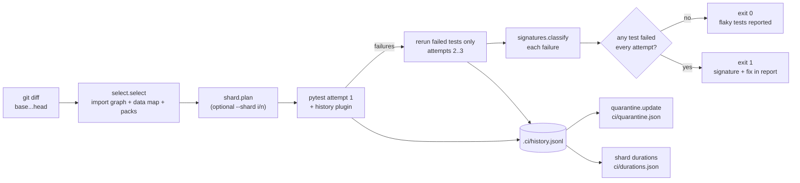

# CI tooling

`casebook/ci/` is the CI system for this repository's own test suite: about 650 tests that drive real SDKs, CLIs, MCP servers and incident sims, take about 3 minutes, and have flaked at least once. Every number on this page comes from running that suite or real git on this machine. Raw results are in [`ci/reports/`](../ci/reports/).

```bash
python -m casebook ci select --base origin/main --explain   # which tests can see this change, and why
python -m casebook ci test --base origin/main               # run them; rerun failures; classify what's left
python -m casebook ci shard -n 3                             # duration-balanced shard plan
python -m casebook ci quarantine update                      # quarantine tests that flipped on one commit
python -m casebook ci classify < failure.log                 # which known failure is this?
```

## How a CI run works



Entry point: [`runner.run`](../casebook/ci/runner.py). On pull requests, `ci.yml` runs `ci test --base origin/<base>`; on pushes it runs everything. `ci-shards.yml` runs the same suite as a 3-job matrix built from the shard plan.

## 1. Test selection

[`select.select`](../casebook/ci/select.py) maps changed files to the tests that can observe them:

| Changed file | Selects |
|---|---|
| A `casebook/` module | Every test file that imports it, directly or through other modules (AST import graph, including imports inside functions and package `__init__` files) |
| `tests/conftest.py`, `requirements.txt`, `pyproject.toml`, `.github/workflows/ci*.yml`, the pytest plugin | Everything |
| Data a module reads at runtime (`ts/`, the packet schema, dossiers, `triage/adversarial.yaml`) | Whatever that module would select (`DATA_DEPS`) |
| One pack under `faults/` | Only the tests that name that pack, plus the tests that read every pack |
| Docs, generated runbooks, reports, `tools/`, `suites/` (each suite has its own workflow) | Nothing |
| Anything else | Everything |

A test file depends on the conftest `mock` fixture's imports only if it uses the fixture; otherwise every change would select everything.

**Is the static graph right?** `tests/test_ci_graph.py` imports every test file for real and checks that every `casebook` module in `sys.modules` is in the graph's dependency set. All 18 test files pass.

Two dependencies the AST can't see are declared by hand at the end of `import_graph`, both found by the mutation experiment below: `test_ci.py` runs `tests/ci_cases/*.py` in subprocesses, so it depends on what they import; `test_ci_graph.py` imports every test module by name, so it is selected by every code change (about 20 s).

**How much does it save?**

| Measurement | Result |
|---|---|
| A change to one module, over all 51 `casebook/` modules (estimated from recorded durations, [`selection-per-module.json`](../ci/reports/selection-per-module.json)) | median **14%** of suite time; 28 modules under 25%; 13 core modules (`rules`, `policy`, `packet`, `redact`, `packs`, the mock…) over 75% |
| Replay over this repo's 16 commits after the first ([`selection-replay.json`](../ci/reports/selection-replay.json)) | 7 ran everything (they changed `requirements.txt`, `pyproject.toml` or a workflow); 5 ran 0–3 test files (0–87 s of 223 s); 4 large feature commits ran 12–14 of 18 files |

The replay uses today's import graph and today's durations for every commit, so it's an estimate. A file counts in full even when only some of its tests were selected.

**Does selection still catch bugs?** [`tools/ci_experiments.py mutate`](../tools/ci_experiments.py) flips one comparison operator in each of 12 modules, in a throwaway worktree, then runs the selected test files and, separately, every other test file. A **selection miss** would be a mutant that only unselected tests catch.

| Run | Caught by selected tests | Caught only by unselected tests (miss) | Caught by nothing |
|---|---|---|---|
| First ([`before-fix`](../ci/reports/selection-mutation-before-fix.json)) | 11 / 12 | 0 | 1 (`policy.call_openai`: dropping the caller's retry trace) |
| After fixes ([`selection-mutation.json`](../ci/reports/selection-mutation.json)) | **12 / 12** | **0** | 0 |

The first run found two real problems, both fixed:
- **A test gap, not a selection gap.** No test anywhere checked the policy's retry trace. `test_policy_trace_records_every_failed_attempt` now does.
- **Hidden dependencies.** For the `packet` and `rules` mutants, unselected tests failed too (the selected ones had already caught them). The cause was the import check in `test_ci.py`, which imports every test module and so depends on all of them. It now lives in `test_ci_graph.py` and that dependency is declared, along with `test_ci.py`'s subprocess cases.

Twelve single-operator mutants are a small sample: they show the graph has no gaps on these paths, not that it has none anywhere.

## 2. Flakes and quarantine

[`pytest_plugin`](../casebook/ci/pytest_plugin.py) writes one history row per test: run, commit, attempt, outcome, setup+call+teardown time, and the failure text. [`quarantine.analyse`](../casebook/ci/quarantine.py) calls a test **flaky** only when it passed and failed **on the same commit**; a test that fails on every attempt is a real failure.

- **Reruns:** `ci test` reruns only the failed tests, up to twice. Pass-on-rerun is reported as flaky and doesn't fail the build; fail-every-time does.
- **Quarantine:** `ci quarantine update` adds tests that flipped on at least one commit to `ci/quarantine.json` (committed, so it's reviewed) and releases them after 30 consecutive passes. A quarantined test still runs and is still recorded as failed in history; the plugin reports its failure as xfail so the build stays green.

**Measured** ([`ci/reports/flakes.json`](../ci/reports/flakes.json)): the full suite (625 tests that run, 1 skipped) five times on one commit through `ci test`, 3,130 test executions, 208–212 s per run. **No test failed and none flipped**, so nothing was quarantined and [`ci/quarantine.json`](../ci/quarantine.json) is empty. The one flake seen while building this repo (`test_oa48_tls_inspection_codex`, an `OSError` during temp-dir cleanup) did not recur after its cleanup was changed to ignore errors; CI-02 is its signature. Five runs can only show that flake rates are low here, not that they are zero.

The detection path itself is tested on a test built to flake (`tests/ci_cases/case_flaky.py`): `test_run_01` shows it fail, pass on rerun, get reported as flaky with exit 0, and appear in history as flipped on one commit; `test_qua_03` shows a quarantined failure kept out of the exit code while history still records it as failed.

## 3. Sharding

[`shard.plan`](../casebook/ci/shard.py) assigns whole test files to N shards, longest first, each to the least-loaded shard. Files stay whole because several build an expensive module-scoped fixture (`test_packs.py` runs every error pack once); splitting them would repeat it in every shard.

Recorded file times ([`ci/durations.json`](../ci/durations.json), means over the five runs above; `test_ci_graph.py` measured once) show why 3 shards is about the useful limit: five files, `test_clients.py` (45.4 s), `test_sims.py` (42.8 s), `test_ci.py` (41.2 s), `test_ts_sdks.py` (30.8 s) and `test_packs.py` (26.0 s), are 84% of the 222.8 s total, and no plan can beat the longest file.

| Shards | Planned slowest shard |
|---|---|
| 1 | 222.8 s |
| 3 | 75.5 s |

**On GitHub Actions** (commit `cbf9f69`, before `test_ci_graph.py` was split out, macOS runners, [`ci/reports/actions-timings.json`](../ci/reports/actions-timings.json)):

| | Test step | Whole workflow |
|---|---|---|
| `ci` (one job, full suite) | 238 s | 4 m 42 s |
| `ci-shards` (plan job + 3 shards) | 106 s, 108 s, 112 s | 3 m 12 s |

The shards came out within 6 s of each other, so the duration-based plan balanced well. The test step got 2.1× faster but the workflow only 1.5×: each shard pays its own checkout, Python and Node setup and dependency install (about 35–45 s per job), plus the 28 s plan job. It also uses about 1.7× the runner time (472 s of jobs vs 279 s). More shards would make the fixed setup cost a larger share.


## 4. Failure signatures

[`signatures.classify`](../casebook/ci/signatures.py) maps failure text to a known cause, with the same shape as the support packs: class, retry Y/N/C, owner, fix. Every signature is matched against a failure actually produced on this machine: the small pytest files in [`tests/ci_cases/`](../tests/ci_cases/) are run in a subprocess by `test_sig_01_signature_matches_reproduced_failure`, and `test_sig_05_every_signature_is_reproduced` fails if a signature has no reproduction.

| Id | Class | Retry | Reproduced by |
|---|---|---|---|
| CI-01 | infra | Y | binding a port that is already listening |
| CI-02 | flake | Y | removing a temp dir after a late write (the OA-48 Codex test failed this way once) |
| CI-03 | infra | Y | a subprocess that outlives its timeout |
| CI-04 | environment | Y | resolving a `.invalid` host |
| CI-05 | dependency | N | `require()` of a package that isn't installed |
| CI-06 | dependency | N | importing a module that isn't installed |
| CI-07 | regression | N | a test file with a syntax error |
| CI-08 | regression | N | `git diff --exit-code` on a stale generated `docs/test-matrix.md` |
| CI-09 | regression | N | `tools/check_docs.py` on a broken link |
| CI-10 | regression | N | an assertion that fails on every attempt |
| CI-00 | unknown | C | anything else: rerun once, then add a signature |

## 5. Merge queue

[`MergeQueue`](../casebook/ci/mergequeue.py) lands branches only after the merged result passes. It merges a batch in a scratch worktree, runs the tests once, and moves the base with a compare-and-swap so a base that moved is never overwritten. A failing batch is bisected; conflicts are ejected without a test run. GitHub's own merge queue needs an organisation-owned repo, so this one runs locally on real git.

Experiment ([`ci/reports/merge-queue.json`](../ci/reports/merge-queue.json)): a generated repo, 16 queued branches, a 0.5 s test suite.

| Batch size | 13 good branches: test runs | Same + 2 breaking + 1 conflicting: test runs |
|---|---|---|
| 1 (serial) | 13 | 15 |
| 2 | 7 | 12 |
| 4 | **4** | **12** |
| 8 | 2 | 14 |

In every case the 13 good branches landed, the 2 breaking branches and the conflict were ejected, and the base branch passed its tests afterwards. Batching cuts test runs by up to 85% when nothing fails, but bisection eats most of the saving when failures are common: at batch 8 with 2 failures it's barely better than serial. `test_mq_01` pins a smaller case where batching is worse than serial (6 runs vs 5).

## What isn't here

- **Kubernetes, multiple clouds, cluster load shedding.** No container runtime is available on this machine, and nothing here simulates one.
- **Monorepo scale.** One repo, about 650 tests, a few CI runs.
- **GitHub's merge queue** (needs an organisation-owned repo).
- **Historical flake data.** CI history has only a handful of runs; flake rates come from repeated local runs.
