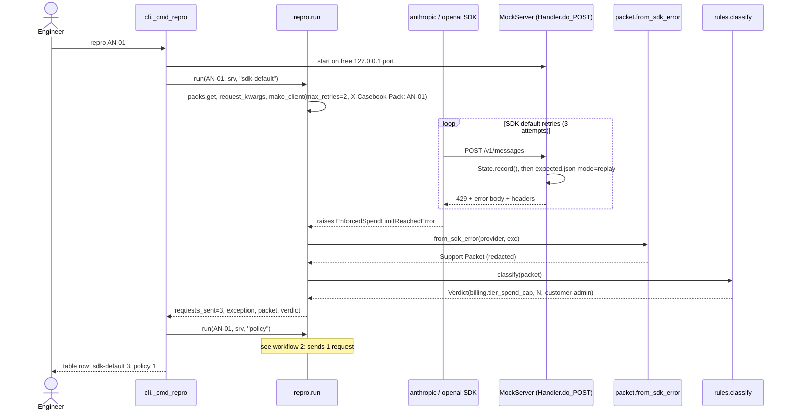
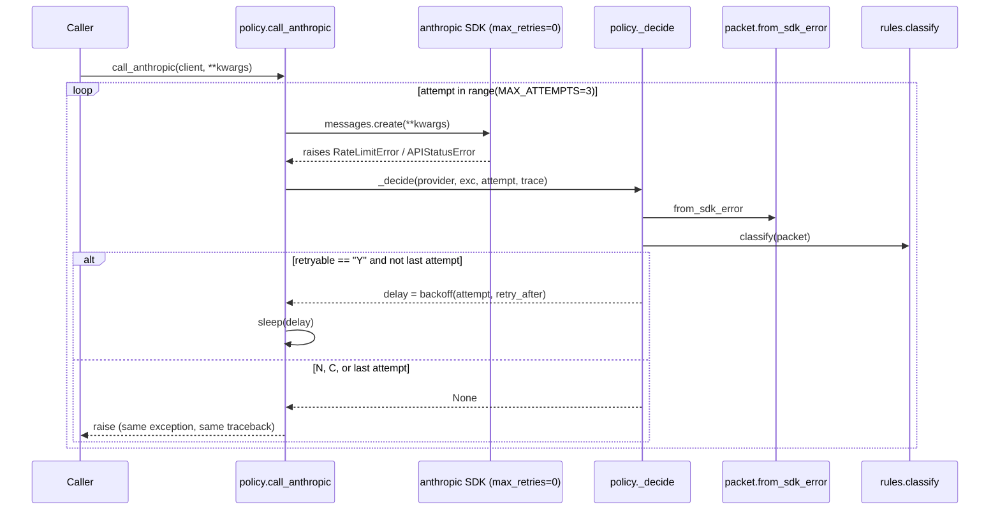
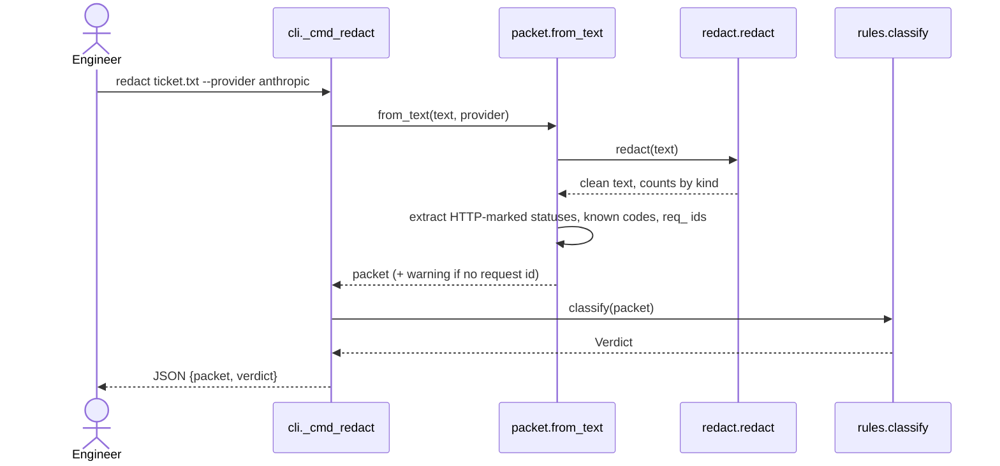
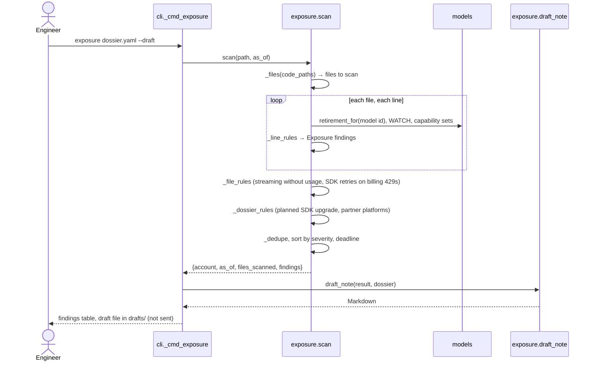
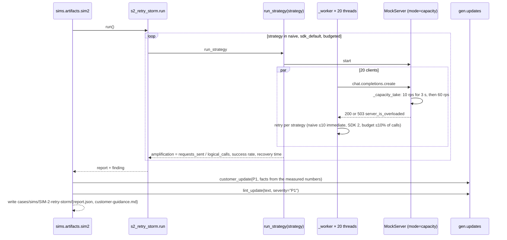
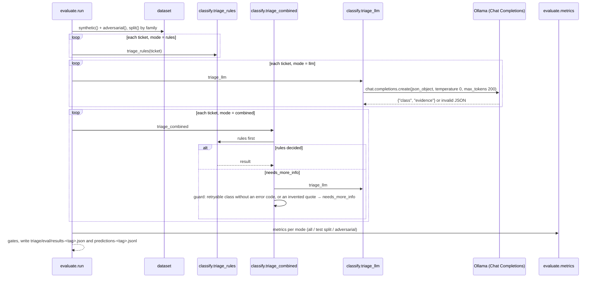

# Workflows

Six workflows cover everything the package does. Each is traced from the actual code. Function names link to their definitions.

| # | Workflow | Entry point | Touches the network? |
|---|---|---|---|
| 1 | [Reproduce an error pack](#1-reproduce-an-error-pack) | `python -m casebook repro <ID>` | 127.0.0.1 only |
| 2 | [Evidence-aware retry](#2-evidence-aware-retry-decision) | inside workflow 1, policy mode | 127.0.0.1 only |
| 3 | [Triage a pasted ticket](#3-triage-a-pasted-ticket) | `python -m casebook redact ticket.txt` | no |
| 4 | [Proactive exposure scan](#4-proactive-exposure-scan) | `python -m casebook exposure <dossier> --draft` | no |
| 5 | [Incident simulation and generated updates](#5-incident-simulation-and-generated-updates) | `python -m casebook repro SIM-2` / `python -m casebook.sims.artifacts` | 127.0.0.1 only (SIM-3's optional live spot check aside) |
| 6 | [Triage evaluation](#6-triage-evaluation) | `python -m casebook.triage.evaluate --model qwen2.5:1.5b` | Ollama on 127.0.0.1 |

A seventh, [live capture](#7-live-capture-opt-in), is the only path that calls a real provider API.

---

## 1. Reproduce an error pack

**Business problem.** A customer reports "429 errors". Several different failures share that status code and need different fixes (see AN-01 vs AN-03 vs OA-04). Support needs to see the exact failure, how many requests the customer's SDK really sent, and what the right verdict is.

**Trigger.** An engineer runs `python -m casebook repro AN-01` (or `all`), or pytest runs `tests/test_packs.py`.

**Execution order** ([`repro.run`](../casebook/repro.py#L55)):
1. [`packs.get`](../casebook/packs.py#L46) loads `pack.yaml` and `expected.json`.
2. [`request_kwargs`](../casebook/repro.py#L41) builds the request; [`make_client`](../casebook/repro.py#L28) creates an SDK client pointed at the mock with the `X-Casebook-Pack` header and `max_retries` 2 (sdk-default) or 0 (policy).
3. `srv.state.reset()` zeroes the request counter.
4. The SDK call runs. On the mock, [`Handler.do_POST`](../casebook/mockserver.py#L166) records the request, looks up the pack, and serves the response its `mode` describes.
5. The SDK raises. `repro.run` picks the packet builder: [`from_client_error`](../casebook/packet.py#L186) for timeouts and connection errors, otherwise [`from_sdk_error`](../casebook/packet.py#L204).
6. [`rules.classify`](../casebook/rules.py#L33) returns the `Verdict`.
7. The result carries `requests_sent` from the mock's counter, all request-ids seen, elapsed time, the exception class, any partial streamed text, the packet and the verdict.

**Data transformation.** HTTP response → SDK exception → raw response body and headers → redacted packet (`http.status`, `error.type/code/details_error_code`, `request_ids`, `rate_headers`, `warnings`) → verdict.

**Success.** The verdict and request count match `pack.yaml` (`test_rules_verdict_matches_pack`, `test_request_counts_python_sdk_default_vs_policy`).

**Failure and fallback.**
- Unknown pack id: the mock replies 400 "unknown casebook pack".
- Pack provider doesn't match the route: 400.
- Stream packs in policy mode are skipped (`"stream packs: policy n/a"`), because the policy wrapper doesn't wrap streams.
- If the SDK raises before sending (AN-10), there's no packet; the scenario path in `scenarios.run` handles that pack instead.

**Outcome.** One row of the repro table: status, code, verdict, retry Y/N/C, requests sent with SDK defaults vs with the policy, and exception class.

The same packs run through the Node SDKs via [`ts_repro.run`](../casebook/ts_repro.py#L21), which shells out to `ts/repro.mjs` and reads the mock's counter the same way.

---

## 2. Evidence-aware retry decision

**Business problem.** Both providers' SDKs retry every 429 and 5xx twice by default, including billing failures the docs call non-retryable. Each retry is a wasted request and delays the real fix.

**Trigger.** `repro.run(..., "policy")`, or any caller using [`policy.call_openai`](../casebook/policy.py#L29) / [`policy.call_anthropic`](../casebook/policy.py#L54) directly.

**Decision logic** ([`_decide`](../casebook/policy.py#L79)):
- Retry only when the verdict's `retryable` is `"Y"` and this isn't the last of `MAX_ATTEMPTS` (3).
- Delay = [`backoff`](../casebook/policy.py#L24): `max(retry_after, 2**attempt + random())`. A server `retry-after` is a floor, never ignored and never replaced.
- Exceptions are caught in the order `RateLimitError` → `APIStatusError` → `APIError`; `APIError` without a status (connection errors) is re-raised immediately.
- Every decision is appended to `trace` (attempt, packet, verdict, sleep), which `repro.run` returns.

**Outcome.** For AN-01, OA-04, OA-05, OA-06 the policy sends 1 request where the SDK default sends 3. For retryable packs (AN-03, AN-04, OA-01…) both send 3. `test_policy_backoff_honours_retry_after` checks that every sleep is at least the server's `retry-after`.

---

## 3. Triage a pasted ticket

**Business problem.** Tickets arrive as free text, often with API keys pasted in. Support needs the secrets removed before anything is stored or sent to a model, and a first verdict that says what evidence is missing.

**Trigger.** `python -m casebook redact ticket.txt --provider anthropic`.

**Processing** ([`from_text`](../casebook/packet.py#L239)):
1. [`redact`](../casebook/redact.py#L36) runs the prefix patterns most-specific first (`sk-ant-admin01-` before `sk-ant-`), including keys wrapped across lines or JSON-escaped.
2. Statuses: an `HTTP 429`-style mention wins over stray numbers (e.g. "limit 500"). Otherwise only known API statuses are kept when several appear.
3. Known error codes are placed in the field the provider uses (`details_error_code` for Anthropic's `enforced_spend_limit_reached`, `type` for `*_error`, otherwise `code`).
4. No `req_…` id → a warning telling support to ask for the request id and a UTC timestamp.

**Decision logic.** `rules.classify` returns a status-only verdict with `retryable` `C` when the ticket has no code. A bare "429" never becomes "retry".

**Failure.** None raised; missing information becomes `None` fields and warnings.

---

## 4. Proactive exposure scan

**Business problem.** Model retirements and API changes break customer code on known dates. An account team that finds this before the customer does can send a dated, specific note instead of handling an outage.

**Trigger.** `python -m casebook exposure cases/dossiers/acme-insurer.yaml --as-of 2026-11-19 --draft`.

**Decision logic** ([`scan`](../casebook/exposure.py#L45)):
- **Severity** from [`_sev_for_date`](../casebook/exposure.py#L40): P1 if already broken or within 14 days, P2 within 60 days, P3 otherwise.
- **Line rules** ([`_line_rules`](../casebook/exposure.py#L78)): retired or retiring model ids, forced `tool_choice` on models that reject it, `thinking.type: enabled` on 4.7+/5.x models, old computer-use tool version, sampling parameters with Claude, Assistants API calls, unguarded `chunk.choices[0]`, deprecated `connector_id`.
- **File rules** ([`_file_rules`](../casebook/exposure.py#L123)): streamed Chat Completions without `include_usage`; API calls with SDK default retries and no billing-code check.
- **Dossier rules** ([`_dossier_rules`](../casebook/exposure.py#L139)): a planned `anthropic` 1.x → 2.x upgrade; Sonnet 4.5 on Bedrock/Vertex, where retirement dates differ.

**Outcome.** A severity-sorted findings list and, with `--draft`, a Markdown note with a customer-ready paragraph for P1 items ([`draft_note`](../casebook/exposure.py#L165)). It writes to `drafts/` (gitignored) and never sends anything. `clean-co` is the control dossier and must produce zero findings (`test_exp_04_clean_integration_has_no_findings`).

---

## 5. Incident simulation and generated updates

**Business problem.** During an incident, support must decide quickly whether the provider or the customer is at fault, tell customers something accurate on a schedule, and avoid advice that makes things worse (like retrying harder).

**Trigger.** `python -m casebook repro SIM-2` (via [`scenarios.run`](../casebook/scenarios.py#L26)) or `python -m casebook.sims.artifacts` to regenerate `cases/sims/`.

SIM-2 (retry storm) as the example:

**Other sims:**
- **SIM-1** ([`s1_outage.run`](../casebook/sims/s1_outage.py#L74)): 10 OpenAI SDK clients call two endpoints while the mock drops connections. [`s1_outage.classify`](../casebook/sims/s1_outage.py#L32) calls it provider-side when at least 60% of clients see connection errors or 5xx on at least 2 endpoints; one client with a revoked key is the control and always reads customer-side. Updates are generated and linted on a 30-minute (simulated) cadence.
- **SIM-3** ([`s3_silent_degradation.run`](../casebook/sims/s3_silent_degradation.py#L82)): a sticky slice of sessions receives corrupted answers with HTTP 200; compares hourly canaries with probes of 10% of real sessions across 20 seeds.

**Generated text.** [`customer_update`](../casebook/gen/updates.py#L25), [`escalation_brief`](../casebook/gen/updates.py#L45) and [`rca`](../casebook/gen/updates.py#L64) build Markdown from measured facts. [`lint_update`](../casebook/gen/updates.py#L76) returns a list of problems; empty means it passes.

**Failure.** Lint problems are returned, not raised, and tests assert the list is empty (`test_sim1_classifies_provider_side_and_updates_lint_clean`).

---

## 6. Triage evaluation

**Business problem.** Can an LLM help triage tickets without ever telling a customer to retry a non-retryable failure or leaking a key?

**Trigger.** `python -m casebook.triage.evaluate --provider ollama --model qwen2.5:1.5b`.

**Decision logic:**
- [`triage_rules`](../casebook/triage/classify.py#L81): four specific documented messages first, then `packet.from_text` + `rules.classify`; anything not code-confident becomes `needs_more_info` unless a documented message phrase matches.
- [`triage_llm`](../casebook/triage/classify.py#L113): redacts before building the prompt; any `APIError` or invalid JSON becomes `needs_more_info` with basis `llm error: …`, which [`metrics`](../casebook/triage/evaluate.py#L45) counts separately so a failing model never looks cautious.
- [`triage_combined`](../casebook/triage/classify.py#L132): rules first; the LLM only sees what rules couldn't decide; retryability always comes from the class table `LABELS`, never from model text.

**Gates.** `false_retryable == 0` and `redaction_leaks == 0` per mode. Rules and combined pass for both models; LLM alone fails the first gate. Committed results are re-checked by `test_committed_report_gates`.

---

## 7. Live capture (opt-in)

**Trigger.** `python -m casebook live OA-07 AN-13 AN-16 --yes`. Packs outside `live.FREE` need `--keyed` and the user's own key.

[`live.capture`](../casebook/live.py#L54) sends one real request with retries off (free packs use a deliberately fake key), redacts headers and body, builds a packet and verdict, diffs the response field by field against `expected.json` ([`live.diff`](../casebook/live.py#L91)), and writes `faults/<provider>/<pack>/live/<date>-python.json`. Without `--yes` the CLI refuses to send. `tests/test_live_captures.py` checks committed captures offline: well-formed, and no secret survives redaction.
